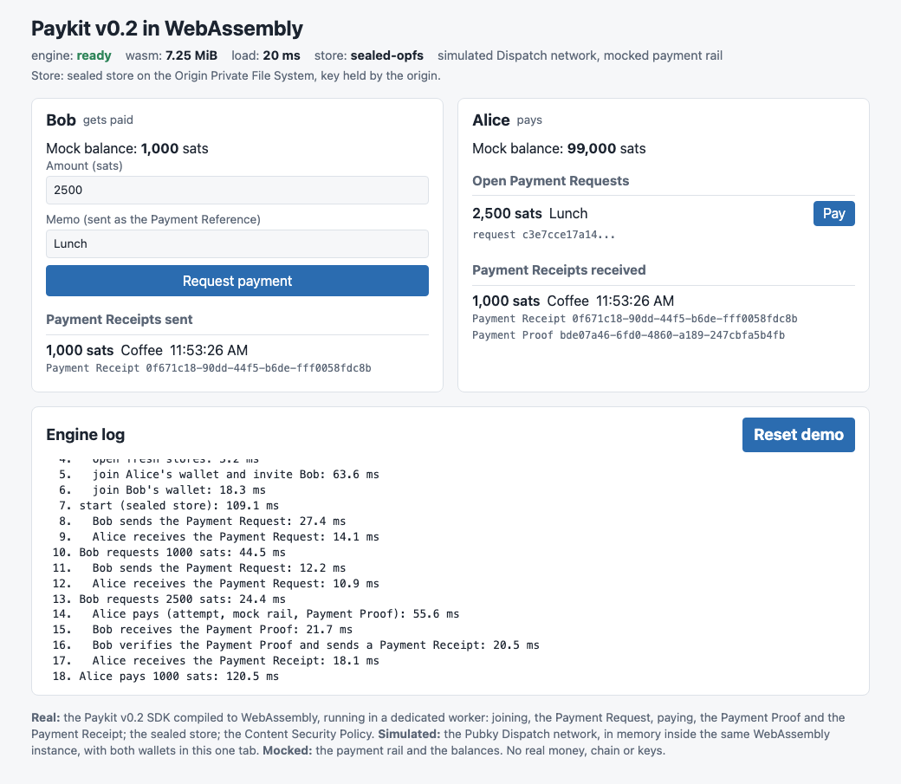

# Paykit v0.2 in WebAssembly: an example web wallet

A minimal example web wallet that runs the [Paykit](https://github.com/pubky/paykit-rs) v0.2
Rust SDK as WebAssembly in a browser worker. It is a proof that the SDK works in a browser,
not a product: two mock wallets, Alice and Bob, in one tab, on a simulated network, with a
mocked payment rail.



## What this proves, and what it does not

**Real:**

- The Paykit v0.2 SDK (`paykit-sdk`), compiled to `wasm32-unknown-unknown`, runs the whole
  one-time Payment Request flow in a dedicated worker: each wallet joins a Paykit App, Bob
  sends a Payment Request, Alice's wallet pays it, Bob's wallet receives the Payment Proof
  and confirms it with a Payment Receipt, and Alice's wallet stores that receipt.
- The sealed store: each wallet's Paykit state is kept on the Origin Private File System,
  every snapshot encrypted and authenticated (paykit-browser's `OpfsStore`).
- After a page reload, the wallets are loaded again from the sealed store with no network
  (`Paykit::load` with a transport that has no routes), and the previous session's Payment
  Receipts are read back and shown.
- A strict Content Security Policy: no inline script, no `eval`; only the worker may compile
  WebAssembly (`'wasm-unsafe-eval'`).

**Simulated or mocked:**

- The network. The Pubky Dispatch services the wallets talk to are in-memory test Dispatches
  (`pubky_dispatch_client::testing`) inside the same WebAssembly instance. Nothing leaves
  the browser. So a reload ends the network, and payments start over in a new world.
- Both wallets live in one tab and one worker.
- The payment rail and the balances. The SDK's `FakeRail` "pays", and the balances are
  numbers this demo moves by what the rail reports it paid. No real money, chain or keys of
  value. The identities' keys are test keys derived from a seed.

**Limits:**

- Tested in Playwright's Chromium, Firefox and WebKit builds. Playwright's WebKit is not
  Safari, and the sealed store was not tested in WebKit at all (see [Test](#test)).
- Paykit's browser support is not merged yet. `Cargo.toml` pins the head of the draft branch
  `feat/browser-csp-worker` of pubky/paykit-rs
  ([pull request #603](https://github.com/pubky/paykit-rs/pull/603), part of a stack of
  browser pull requests), pinned to `0e1db21`. The pin must move when that stack merges.
- The evidence against a real Dispatch service, over a real network, is in those pull
  requests (#603 and the stack it builds on), not here.

## Run it

You need Rust (stable; `rust-toolchain.toml` adds the `wasm32-unknown-unknown` target),
Node.js 20 or later, and the wasm-bindgen CLI at the version in `Cargo.lock`:

```sh
cargo install wasm-bindgen-cli --version 0.2.130 --locked
./build.sh
node serve.mjs
```

Then open <http://localhost:8080/>. `PORT=9000 node serve.mjs` serves on another port.
Add `?store=memory` to the URL to keep both wallets in memory instead of the sealed store.

`build.sh` builds the crate in the size-optimized `browser-release` profile and runs
`wasm-bindgen --target web` into `web/pkg/` (not committed). It prints the sizes. Its warning
that the `target_features` section is missing comes from `strip = true`, and is expected.

## Test

```sh
npm ci --ignore-scripts
npx playwright install chromium firefox webkit   # once, if you have no Playwright browsers
node test/smoke.mjs chromium                     # or firefox, webkit
node test/smoke.mjs chromium --negative          # the negative control
```

The smoke test starts `serve.mjs` on a free port, checks both policy headers, opens the
page and waits for the engine. Bob requests 1,000 sats and Alice pays. It checks that the
mock balances moved (100,000 to 99,000 for Alice, 0 to 1,000 for Bob), that the request is
no longer open, and that the same Payment Receipt shows on both sides. Then it reloads: with
the sealed store, that Payment Receipt must show under "from the previous session"; with the
memory store, there is nothing to read back. Then it clicks "Reset demo". Any console error,
page error or policy violation fails the run. The negative control serves the worker
without `'wasm-unsafe-eval'`: the engine must fail to start with a `CompileError`, and the
page must say so.

On macOS, Playwright's WebKit shows a Keychain dialog when a page stores a WebCrypto key in
IndexedDB, which the sealed store does. So the test runs WebKit on macOS with
`?store=memory` (`--store=sealed` overrides that). On Linux, Playwright's WebKit has no
Origin Private File System, so the page falls back to memory, says why, and the test expects
that.

| Engine | Where | Store |
| --- | --- | --- |
| Chromium 151 | macOS (local), Linux (CI) | sealed |
| Firefox 153 | macOS (local), Linux (CI) | sealed |
| WebKit 26.5 | macOS (local) | memory (`?store=memory`, Keychain dialog) |
| WebKit 26.5 | Linux (CI) | memory (fallback: no Origin Private File System) |

The [workflow](.github/workflows/demo.yml) builds, keeps the built `web/` folder as an
artifact, and runs the smoke test and the negative control in all three engines.

## Measured

At paykit-rs `0e1db21`, on an Apple Silicon Mac, `browser-release` build, Playwright 1.62.1,
two runs each:

| | Raw | gzip -9 |
| --- | --- | --- |
| `paykit_wasm_wallet_demo_bg.wasm` | 7,380,728 bytes | 2,744,226 bytes |
| `paykit_wasm_wallet_demo.js` (glue) | 36,766 bytes | 7,470 bytes |

| Engine (store) | Load | Start | Request | Pay, Proof and Receipt |
| --- | --- | --- | --- | --- |
| Chromium (sealed) | 17 to 18 ms | 107 to 115 ms | 40 to 42 ms | 108 ms |
| Chromium (memory) | 13 ms | 70 to 71 ms | 36 ms | 86 to 87 ms |
| Firefox (sealed) | 171 to 178 ms | 409 to 414 ms | 244 to 248 ms | 982 to 1,015 ms |
| Firefox (memory) | 166 to 168 ms | 352 to 356 ms | 217 to 218 ms | 838 to 842 ms |
| WebKit (memory) | 26 to 27 ms | 64 to 68 ms | 32 to 38 ms | 96 ms |

Load is the worker's fetch, compile and instantiate of the `.wasm`. The other columns are
whole calls as the page sees them: start reads back the last session, opens fresh stores and
joins both wallets; pay covers the payment, the Payment Proof, the Payment Receipt, and both
wallets receiving. Chromium compiles lazily, so its load figure leaves out most compilation.
Firefox is slower with either store; the sealed store adds about 15 percent there.

## How it fits together

```text
index.html + app.js  (page: no WebAssembly, plain-data messages only)
        |  { id, op, args }  /  { id, ok, value | error }
        v
worker.js            (dedicated module worker, its own policy with 'wasm-unsafe-eval')
        |
        v
pkg/*.wasm           (the Rust crate in src/: Paykit SDK, simulated network, mock rail)
        |
        v
Origin Private File System + IndexedDB  (sealed store and its wrapped key)
```

- `src/lib.rs`: the five functions the worker calls (`start`, `requestPayment`, `pay`,
  `state`, `reset`), and why the engine lives in a worker and how promises and futures meet.
- `src/engine.rs`: the two wallets and the Payment Request flow.
- `src/world.rs`: the simulated network (simulated).
- `src/ledger.rs`: the balances and amount conversion (mocked).
- `src/store.rs`: the sealed store, with the fallback to memory.
- `src/previous.rs`: reading back the previous session after a reload.
- `build.rs`: the module's 2 MiB stack, and why.
- `web/`: the page, the worker, the styles.
- `serve.mjs`: the local server and its policies.
- `test/smoke.mjs`: the Playwright smoke test.

If the worker reports an error, or a call fails with a `RuntimeError` (a Rust panic stops
the WebAssembly instance for good), the page shows "Wallet engine stopped" and offers
"Restart engine", which terminates the worker and starts a new one.

## The Content Security Policy

`serve.mjs` binds to `127.0.0.1` only and sends these policies. A dedicated worker runs
under the policy of its own script's response, not its page's, so the worker gets its own.

On the page and every file but the worker script:

```text
default-src 'none'; script-src 'self'; style-src 'self'; img-src 'self'; worker-src 'self'; connect-src 'self'; base-uri 'none'; form-action 'none'; frame-ancestors 'none'
```

On `worker.js`:

```text
default-src 'none'; script-src 'self' 'wasm-unsafe-eval'; connect-src 'self'; base-uri 'none'; form-action 'none'; frame-ancestors 'none'
```

`'wasm-unsafe-eval'` allows compiling WebAssembly without allowing JavaScript `eval`.
`node serve.mjs --no-wasm-eval` leaves it out, for the negative control. The `.wasm` is sent
as `application/wasm`, which streaming compilation needs.

## License

MIT, as Paykit itself. See [LICENSE](LICENSE).
